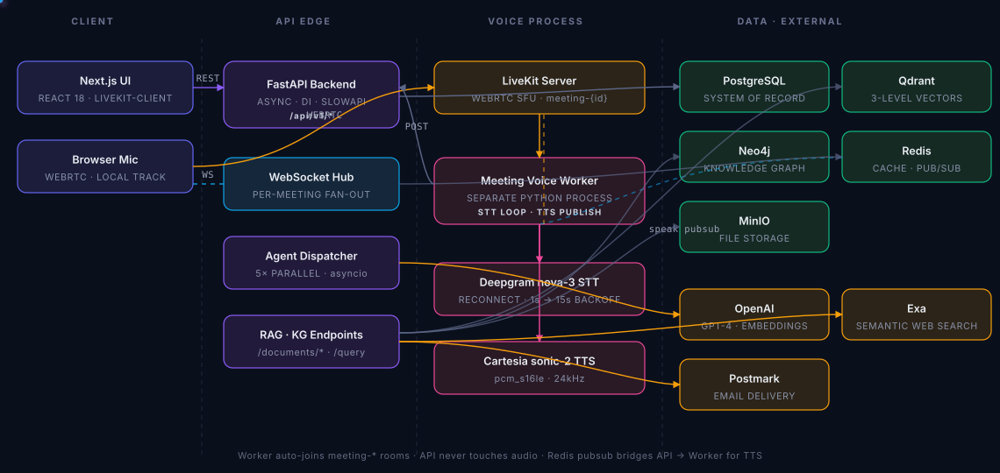
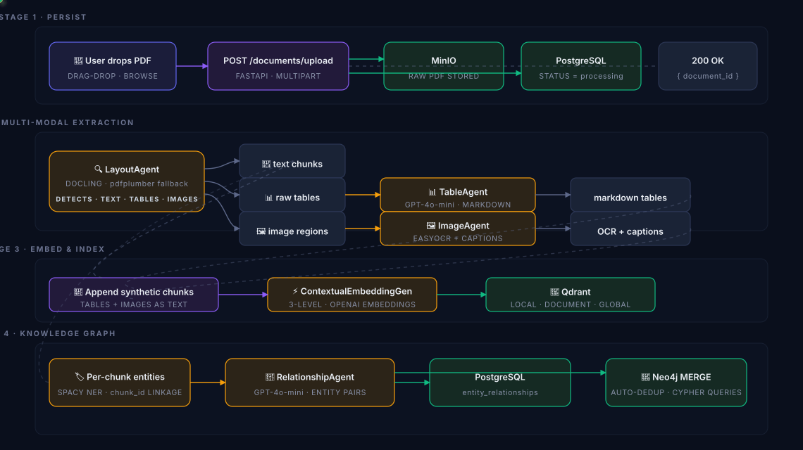
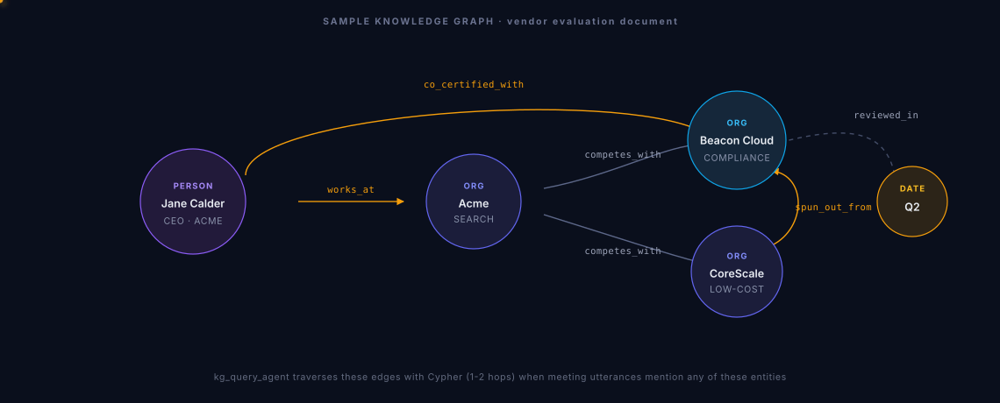
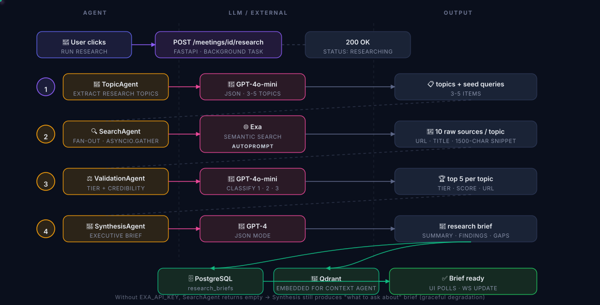
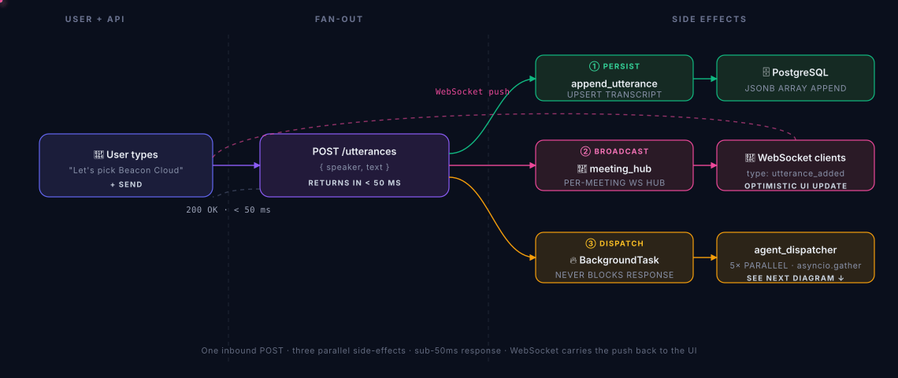
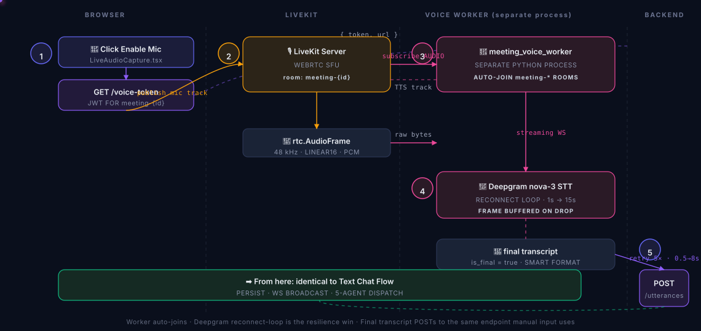
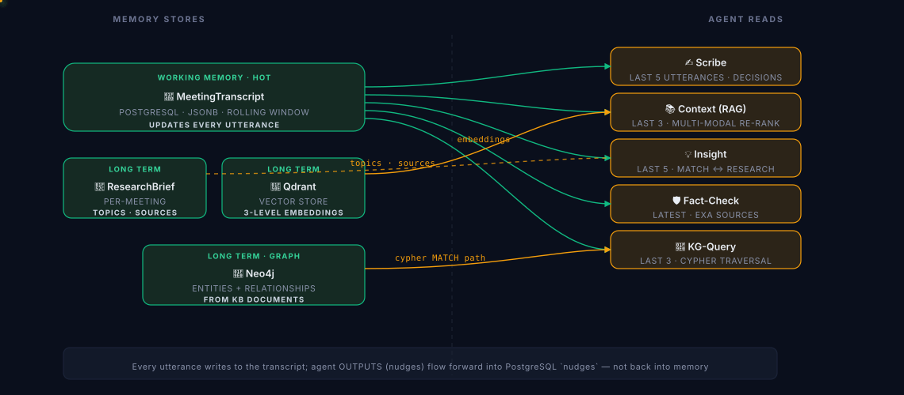
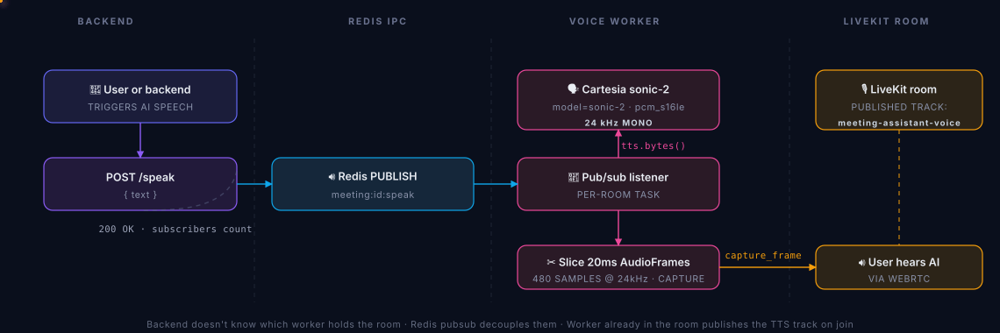
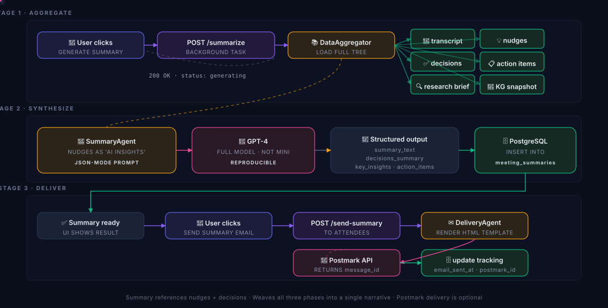

# Donna — AI Meeting Intelligence That's Always a Step Ahead

> *"She already knew."*
>
> Donna is your AI meeting partner, inspired by the one from Suits — she does the homework before you walk in, surfaces exactly the right intel while you talk, and has the summary ready before you ask. Documents become a queryable knowledge graph, pre-meeting research is auto-generated, real-time agents surface proactive nudges during the meeting, and a structured summary is delivered after.


> **📊 For the interactive, animated presentation, open** [`VOICE_DOC_DEMO_PRESENTATION.html`](VOICE_DOC_DEMO_PRESENTATION.html) — every diagram below is rendered there with custom SVG, animated flow particles, and pulsing focus nodes. This README is the static text equivalent.

---

## Table of Contents

- [Overview](#overview)
- [Tech Stack](#tech-stack)
- [Architecture](#architecture)
- [Phase 0 — Knowledge Base](#phase-0--knowledge-base-document-intelligence)
- [Phase 1 — BEFORE: Pre-Meeting Research](#phase-1--before-pre-meeting-research)
- [Phase 2 — DURING: Live Meeting](#phase-2--during-live-meeting)
  - [Text chat flow](#a-text-chat-flow)
  - [Voice chat flow](#b-voice-chat-flow)
  - [5-agent fan-out](#c-the-five-meeting-agents)
  - [Memory & context](#d-memory--context)
  - [TTS speakback](#e-tts-speakback)
- [Phase 3 — AFTER: Summary & Delivery](#phase-3--after-summary--delivery)
- [API Reference](#api-reference)
- [Setup & Development](#setup--development)
- [Testing](#testing)
- [Production Patterns](#production-patterns)
- [Trade-offs](#trade-offs)
- [What's Not Done (Honest)](#whats-not-done-honest)

---

## Overview

Three temporal phases, fifteen specialized agents, one continuous data flow. Each phase enriches the data model the next phase consumes.

| Phase | What happens | Agents |
|---|---|---|
| **0 · Knowledge Base** | PDFs → text + tables + images + entity graph | 4 (Layout · Table · Image · Relationship) |
| **1 · BEFORE** | Pre-meeting web research → executive brief | 4 (Topic · Search · Validation · Synthesis) |
| **2 · DURING** | Live transcript → parallel nudge cards | 5 (Scribe · Context · Insight · Fact-Check · KG-Query) |
| **3 · AFTER** | Aggregate everything → structured summary → email | 2 (Summary · Delivery) |

### Headline capabilities

- **Multi-modal document intelligence** — Docling for layout, pdfplumber for tables, EasyOCR for charts, GPT-4o-mini to normalize. Tables and images become first-class searchable elements.
- **Real knowledge graph (Neo4j)** — Cypher traversal during meetings. Entities deduped via `MERGE`. Multi-hop paths drive in-meeting nudges.
- **Five parallel meeting agents** — Scribe, Context, Insight, Fact-check, KG-traversal. Run via `asyncio.gather` after each utterance.
- **Real voice pipeline** — LiveKit WebRTC, Deepgram nova-2-meeting streaming STT, Cartesia sonic-2 TTS. Worker auto-joins `meeting-<id>` rooms with reconnect + retry.
- **Resilience first** — Circuit breakers per provider, retry with backoff, structured logs, Prometheus, rate limiting.
- **Live UI updates** — Per-meeting WebSocket fans nudges + utterances to the React UI. 30s heartbeat is the safety net only.

---

## Tech Stack

| Layer | Technology |
|---|---|
| **Backend** | FastAPI · SQLAlchemy 2.0 async · asyncpg · PostgreSQL 15 · Redis 7 · Qdrant · Neo4j 5 · MinIO · structlog · Prometheus · slowapi · tenacity |
| **AI / ML** | OpenAI GPT-4 / 4o-mini · text-embedding-3-small · spaCy NER · Docling · EasyOCR · NetworkX · sentence-transformers |
| **Voice / Real-time** | LiveKit WebRTC · livekit-agents · Deepgram nova-2-meeting · Cartesia sonic-2 · Silero VAD · WebSocket fan-out |
| **External / Frontend** | Exa web search · Postmark email · Next.js 14 · React 18 · TypeScript · Tailwind CSS · livekit-client |

---

## Architecture

Three-tier: frontend (Next.js) → API (FastAPI) → data layer (Postgres + Redis + Qdrant + Neo4j + MinIO). Voice runs as a **separate process** that joins LiveKit rooms — the API never touches audio.

<p align="center">
  
</p>

> *Solid lines = sync REST · Dashed = WebSocket / pub-sub · Amber edges = WebRTC + LLM hops · Animated dots show live request paths.*

**Key flows:**
- Browser publishes mic track to LiveKit → worker auto-joins → Deepgram streams transcripts back → POST to API → 5 agents fire in parallel.
- Backend can push text-to-speak via Redis pub/sub → worker synthesizes via Cartesia → publishes audio track back into the room.

---

## Phase 0 — Knowledge Base (Document Intelligence)

PDFs enter the system, four specialized agents extract structure (text, tables, images, entities, relationships), and the result lands in three stores: **PostgreSQL** (records), **Qdrant** (3-level contextual vectors), and **Neo4j** (knowledge graph).

### Upload & processing pipeline

<p align="center">
  
</p>

### The four document agents

| Agent | Role | Implementation |
|---|---|---|
| **LayoutAgent** | Docling first; falls back to pdfplumber. Detects text blocks, tables, images, page boundaries. | `apps/api/services/document/layout_agent.py` |
| **TableAgent** | Raw nested-list tables → markdown via GPT-4o-mini cleanup. Normalizes headers, removes empty rows. | `apps/api/services/document/table_agent.py` |
| **ImageAgent** | EasyOCR extracts text from image regions; PyMuPDF crops bboxes; describes via positioned captions. | `apps/api/services/document/image_agent.py` |
| **RelationshipAgent** | Per-chunk: spaCy NER entities → GPT-4o-mini extracts `works_at`, `part_of`, `decided_on`, etc. | `apps/api/services/document/relationship_agent.py` |

### Knowledge graph — dual-store design

**PostgreSQL** is the system of record (foreign-key integrity to documents/chunks). **Neo4j** is the query layer — multi-hop traversal during meetings happens in Cypher, not in-memory NetworkX. Entity dedup is automatic via `MERGE (e:Entity {normalized, type})`.

<p align="center">
  
</p>

`kg_query_agent` traverses these edges with Cypher (1-2 hops) when meeting utterances mention any of these entities.

**Trade-offs:**

| Pro | Con |
|---|---|
| Free entity dedup via `MERGE` — 5 spaCy hits of "Acme" collapse into one node | Two writes per relationship (best-effort Neo4j mirror — never blocks upload) |
| Cypher path queries in milliseconds; NetworkX-in-memory wouldn't scale past 10k edges | Eventual consistency between PostgreSQL and Neo4j (mitigated by automatic fallback on read) |

### Knowledge Base APIs

| Method | Path | Description |
|---|---|---|
| `POST` | `/api/v1/documents/upload` | Multipart upload. Stores to MinIO, kicks off background pipeline. |
| `GET` | `/api/v1/documents/{id}` | Document metadata + chunks + processing status + KG stats. |
| `GET` | `/api/v1/documents/{id}/elements` | Tables + images + charts extracted by the enhanced pipeline. |
| `GET` | `/api/v1/documents/{id}/knowledge-graph` | Entities + relationships as `{nodes, edges}`. Neo4j-first with PostgreSQL fallback. Response includes `"source": "neo4j" \| "postgresql"`. |
| `POST` | `/api/v1/query` | RAG query across all uploaded docs. Uses `ModernRAGService` + LlamaIndex query routing. |
| `DELETE` | `/api/v1/documents/{id}` | Cascading delete: chunks, Qdrant embeddings, entities, MinIO file. |

---

## Phase 1 — BEFORE: Pre-Meeting Research

The user creates a meeting and clicks **Run Pre-Meeting Research**. A 4-agent pipeline extracts topics, fetches web sources, validates them, and synthesizes an executive brief — all in under a minute.

<p align="center">
  
</p>

### Research agents

| Agent | Role |
|---|---|
| **TopicAgent** | GPT-4o-mini reads the meeting title + description, extracts 3-5 research-worthy topics with seed queries. |
| **SearchAgent** | Exa `search_and_contents` with `use_autoprompt=True`. Per-query 1500-char text snippets, dedup by URL. |
| **ValidationAgent** | GPT-4o-mini classifies each source into Tier 1 (academic/official), 2 (reputable outlet), 3 (forum/blog). Filters to top 5. |
| **SynthesisAgent** | GPT-4 produces the executive summary, key findings per topic, identified data gaps. JSON-mode output for reliability. |

> **Graceful degradation:** without `EXA_API_KEY`, the SearchAgent returns empty results and the SynthesisAgent operates on topics alone — a still-useful "what we should ask about" brief, just no live web grounding.

### Research APIs

| Method | Path | Description |
|---|---|---|
| `POST` | `/api/v1/meetings/{id}/research` | Trigger the research pipeline as a background task. |
| `GET` | `/api/v1/meetings/{id}/research` | Fetch the research brief (topics, sources, executive summary). |

---

## Phase 2 — DURING: Live Meeting

The centerpiece. **Two input modes** — manual text utterances OR real audio via LiveKit — fan into one backend endpoint, which dispatches five agents in parallel and pushes nudges over a meeting-scoped WebSocket. The bot can also speak back via Cartesia TTS.

### A. Text chat flow

The simpler, demo-reliable path. The user types into the speaker dropdown + text box in the live meeting room. Same backend pipeline as voice — only the input source differs.

<p align="center">
  
</p>

### B. Voice chat flow

The full real-time path. The browser publishes a mic track to a LiveKit room named `meeting-<id>`. A **separate Python worker** auto-joins that room, streams every participant's audio to Deepgram, and POSTs final utterances to the same endpoint manual input uses.

<p align="center">
  
</p>

**Worker resilience:**
- **Deepgram reconnect** — outer `while True:` loop wraps the WS lifecycle. Drops trigger reconnect with backoff (1s → 15s cap). The in-flight audio frame at the moment of disconnect is buffered and re-sent on the next successful connect — no lost speech.
- **POST retry** — 5 attempts at 0.5s → 8s exponential backoff. Retries on connection errors + 5xx, gives up on 4xx (those need config fixes, not retries).

**Why a separate process?** The voice worker runs *outside* FastAPI as its own Python process. Dedicated event loop for audio I/O, unaffected by API request latency or restarts. It connects to the LiveKit cluster, not to the API.

### C. The Five Meeting Agents

After every utterance, `agent_dispatcher.dispatch()` fans out via `asyncio.gather(return_exceptions=True)`. One agent's failure does not block the batch. Each agent returns either a nudge dict or `None`.

<p align="center">
  
</p>

| Agent | What it does | Cheap pre-check |
|---|---|---|
| **Scribe** | Detects decision patterns (`"let's go with"`, `"agreed"`) → GPT-4o-mini extracts the decision text. Emits `decision_prompt` nudge. | Regex gate before LLM |
| **Context** | Embeds last 3 utterances → Qdrant top-K=5. **Multi-modal aware:** table chunks get 1.15× boost when query is data-heavy. Emits `context` nudge. | ≥ 20 char query length |
| **Insight** | Matches utterance against pre-meeting research topics via GPT-4o-mini. Emits `insight` nudge citing the source. | Pre-fetched topics, no per-call I/O |
| **Fact-Check** | Claim-pattern regex (percentages, attributions) → GPT extracts claim → Exa retrieves sources → GPT verdict. | Regex + SHA1 claim hash + 45s global throttle |
| **KG-Query** | **spaCy NER** extracts entities (catches lowercase!) → Cypher `MATCH path = (a)-[:REL*1..2]-(b)` → emits novel connection as `knowledge_graph` nudge. | 90s per (src,tgt) cooldown |

### D. Memory & Context

"Memory" in this system is concrete: it's the union of four stores the agents pull from. There's no LLM-side scratchpad — every agent decision is reproducible from the data layer.

<p align="center">
  
</p>

**Per-agent windowing:**

| Agent | Window | Stores Read | Cost guard |
|---|---|---|---|
| Scribe | Last 5 utterances | Transcript | Regex gate before GPT |
| Context | Last 3 utterances | Transcript + Qdrant | ≥20 char min query length |
| Insight | Last 5 utterances | Transcript + ResearchBrief | Pre-fetched topics |
| Fact-check | Latest utterance | Transcript + Exa | Regex + claim hash + 45s throttle |
| KG-Query | Last 3 utterances | Transcript + Neo4j | 90s per (src,tgt) cooldown |

### E. TTS Speakback

The bot can speak back inside the meeting. The backend publishes text to a Redis channel; the worker (already in the room) subscribes, synthesizes via Cartesia, and pushes audio frames into the room.

<p align="center">
  
</p>

Backend doesn't know which worker holds the room — Redis pubsub decouples them. The worker already in the room publishes the TTS track on join.

### DURING APIs

| Method | Path | Description |
|---|---|---|
| `POST` | `/api/v1/meetings/{id}/start` | Transition to `in_progress`. |
| `POST` | `/api/v1/meetings/{id}/utterances` | Body `{speaker, text}`. Appends, broadcasts WS, triggers dispatcher. |
| `GET` | `/api/v1/meetings/{id}/transcript` | Full transcript + accumulated full_text. |
| `GET` | `/api/v1/meetings/{id}/nudges` | Persisted nudges (WebSocket is primary delivery). |
| `POST` | `/api/v1/meetings/{id}/decisions` | Body `{decision_text, source_nudge_id?, owner?, deadline?}`. Wires nudge-to-decision lineage. |
| `POST` | `/api/v1/meetings/{id}/action-items` | Body `{description, assignee?, deadline?, priority?}`. |
| `GET` | `/api/v1/meetings/{id}/voice-token` | LiveKit JWT scoped to room `meeting-{id}`. |
| `POST` | `/api/v1/meetings/{id}/speak` | Body `{text}`. TTS speakback via Redis → worker → Cartesia. |
| `WS` | `/api/v1/meetings/{id}/ws` | Per-meeting WebSocket: `utterance_added`, `nudge_created` events. |
| `POST` | `/api/v1/meetings/{id}/end` | Transition to `completed`. |

---

## Phase 3 — AFTER: Summary & Delivery

Once the meeting ends, the user clicks **Generate Summary**. Two agents aggregate the full data tree (transcript, nudges, decisions, action items, research brief, knowledge graph snapshot) and produce a structured summary, optionally delivered by email.

<p align="center">
  
</p>

| Agent | Role |
|---|---|
| **SummaryAgent** | GPT-4 (full model, not mini). Prompt includes transcript excerpt + nudge list + decisions + research-brief context. JSON-mode response. |
| **DeliveryAgent** | Renders an HTML email template, sends via Postmark API. Stores `postmark_id` for delivery tracking. |

### AFTER APIs

| Method | Path | Description |
|---|---|---|
| `POST` | `/api/v1/meetings/{id}/summarize` | Trigger the summary pipeline as a background task. Idempotent. |
| `GET` | `/api/v1/meetings/{id}/summary` | Fetch the structured summary. |
| `POST` | `/api/v1/meetings/{id}/send-summary` | Email summary to attendees via Postmark. 503 when key missing. |

---

## API Reference

All endpoints prefixed under `/api/v1/`. Base URL: `http://localhost:8000`.

### Documents
- `POST /api/v1/documents/upload` — Multipart upload, async processing
- `GET /api/v1/documents` — List with pagination
- `GET /api/v1/documents/{id}` — Detail + chunk count + KG stats
- `GET /api/v1/documents/{id}/elements` — Tables / images extracted
- `GET /api/v1/documents/{id}/knowledge-graph` — Neo4j-first with PostgreSQL fallback
- `DELETE /api/v1/documents/{id}` — Cascading delete

### Query (RAG)
- `POST /api/v1/query` — RAG over all documents

### Meetings — Lifecycle
- `POST /api/v1/meetings` — Create
- `GET /api/v1/meetings` — List
- `GET /api/v1/meetings/{id}` — Full tree (meeting + transcript + research + nudges + decisions + summary)
- `POST /api/v1/meetings/{id}/start` — Transition to `in_progress`
- `POST /api/v1/meetings/{id}/end` — Transition to `completed`
- `DELETE /api/v1/meetings/{id}` — Delete

### Meetings — BEFORE
- `POST /api/v1/meetings/{id}/research` — Trigger research pipeline
- `GET /api/v1/meetings/{id}/research` — Get research brief

### Meetings — DURING
- `POST /api/v1/meetings/{id}/utterances` — Append utterance, broadcast WS, dispatch agents
- `GET /api/v1/meetings/{id}/transcript` — Get transcript
- `GET /api/v1/meetings/{id}/nudges` — Persisted nudges
- `POST /api/v1/meetings/{id}/decisions` — Log decision (supports `source_nudge_id`)
- `POST /api/v1/meetings/{id}/action-items` — Log action item
- `GET /api/v1/meetings/{id}/voice-token` — LiveKit JWT for meeting room
- `POST /api/v1/meetings/{id}/speak` — TTS speakback via Redis → worker → Cartesia
- `WS /api/v1/meetings/{id}/ws` — Per-meeting event stream

### Meetings — AFTER
- `POST /api/v1/meetings/{id}/summarize` — Generate structured summary
- `GET /api/v1/meetings/{id}/summary` — Get summary
- `POST /api/v1/meetings/{id}/send-summary` — Email via Postmark

### Health & Observability
- `GET /health` — Liveness + readiness + circuit breaker states
- `GET /metrics` — Prometheus exposition

---

## Setup & Development

### Prerequisites

- **Python 3.13** (project pins `>=3.13,<3.14`)
- **Node.js 18+**
- **Docker & Docker Compose** (for Postgres / Redis / Qdrant / Neo4j / MinIO / LiveKit)
- **API keys** (only `OPENAI_API_KEY` is required; others enable optional features):
  - `OPENAI_API_KEY` — agents + embeddings (**required**)
  - `EXA_API_KEY` — pre-meeting web research
  - `POSTMARK_API_KEY` — email delivery
  - `DEEPGRAM_API_KEY`, `CARTESIA_API_KEY` — voice
  - `LIVEKIT_API_KEY`, `LIVEKIT_API_SECRET`, `LIVEKIT_URL` — voice rooms

### Installation

```bash
# Clone
git clone <your-repo-url>
cd voice-doc-intelligence

# Copy and fill in env
cp .env.example .env

# Python deps (uses uv)
uv sync --extra dev

# Frontend deps
cd apps/web && npm install && cd ../..
```

### Run the stack

```bash
# 1. Infrastructure (Postgres, Redis, Qdrant, Neo4j, MinIO, LiveKit)
docker compose -f infrastructure/local/docker-compose.yml up -d

# 2. Backend
uv run uvicorn apps.api.main:app --reload

# 3. Voice worker (optional — only if using real audio)
uv run python -m apps.workers.meeting_voice_worker dev

# 4. Frontend
cd apps/web && npm run dev
```

Then open `http://localhost:3000`.

### End-to-end demo seeder

A self-contained script that walks the entire meeting lifecycle against the running API:

```bash
# Synthetic text doc (fast, no PDF features)
uv run python scripts/seed_meeting_demo.py

# Or with a real PDF (exercises layout/table/image agents)
uv run python scripts/seed_meeting_demo.py --pdf path/to/file.pdf

# Skip Exa research if no key
uv run python scripts/seed_meeting_demo.py --skip-research
```

The script: uploads a doc → creates a meeting → runs research → streams 7 scripted utterances → ends meeting → generates summary → prints a final report.

### Useful commands

```bash
# Lint
uv run ruff check apps/ tests/

# Format
uv run ruff format apps/ tests/

# Run all tests
uv run pytest tests/ --timeout=60

# Run a single test
uv run pytest tests/unit/test_meeting_agents.py -v

# Database migrations
uv run alembic upgrade head
uv run alembic revision --autogenerate -m "description"
```

---

## Testing

**83 tests passing** across unit + integration:

```bash
uv run pytest tests/ --timeout=60 -q
# === 83 passed in 15.46s ===
```

Coverage highlights:
- **Unit tests** — every agent's pre-check path (regex gates, cooldowns), Neo4j client graceful degradation, WebSocket fan-out (`MeetingHub`), spaCy NER extraction (including lowercase entities)
- **Integration tests** — full meeting dispatch loop with 5 mocked agents, persistence + WebSocket broadcast, failure isolation (one agent raising doesn't break the batch), empty-transcript early-return
- **RAG integration** — full upload-to-query pipeline with Qdrant + PostgreSQL

The integration test in `tests/integration/test_meeting_dispatch_flow.py` is the layer above unit tests, below "requires running Postgres + Neo4j + Qdrant" — it would catch regressions where the dispatcher silently dropped agents.

---

## Production Patterns

| Pattern | Implementation |
|---|---|
| **Resilient external calls** | Every OpenAI / Exa / Deepgram / Postmark call goes through `@resilient_call(provider)` — tenacity retry + per-provider circuit breaker + timeout + Prometheus metrics. Per-provider state means a Deepgram outage doesn't trip Postmark's breaker. |
| **Dependency injection** | One `ServiceContainer` built in the FastAPI lifespan, injected via `request.app.state.services`. Tests swap services trivially — no globals. |
| **Structured logging** | structlog with request-ID propagation; every external call logs `provider`, `duration_ms`, `success`. JSON in production, console in dev. `/metrics` exposes Prometheus. |
| **Rate limiting** | slowapi backed by Redis. Per-endpoint via `@limiter.limit(settings.rate_limit_upload)`. Disabled cleanly in tests. |
| **Async-first end-to-end** | SQLAlchemy 2.0 async + asyncpg + AsyncSession. No sync DB calls anywhere. `asyncio.gather` for parallel fan-outs. |
| **Cooldowns & spam guards** | Fact-check has SHA1-hashed claim cache + 45s global throttle. KG-query has per-(src,tgt) 90s cooldown. Cheap regex pre-checks gate every LLM call. |
| **WebSocket optimistic updates** | The UI appends nudges/utterances to local state on `nudge_created`/`utterance_added` events instead of re-fetching the meeting tree. Heartbeat fallback every 30s. |
| **Background-task dispatch** | API responds in < 50ms; agent fan-out runs as a FastAPI BackgroundTask so the UI never blocks on LLM latency. |

---

## Trade-offs

Honest design decisions — what was bought, what was paid for it.

| Decision | What we gain | What we pay |
|---|---|---|
| **Neo4j + PostgreSQL dual-write** | Free entity dedup via MERGE; fast Cypher traversal; relational FK integrity | Two writes per relationship; eventual consistency (mitigated by best-effort mirror + automatic fallback on read) |
| **Voice worker as separate process** | Dedicated audio event loop; isolated from API request latency; matches LiveKit's deployment model | Cross-process IPC (Redis pubsub for TTS); harder to share in-memory state |
| **WebSocket optimistic update** | ~0ms perceived latency; no full-tree refetch per event | Frontend state must be reconciled on heartbeat; possible duplicate on reconnect (mitigated via id-dedup) |
| **Cheap pre-checks on every agent** | ~80% of utterances skip the LLM entirely; demo runs < $0.50 OpenAI | Regex / length heuristics can miss edge cases; tuned for English business meetings |
| **Background-task dispatch** | API responds in < 50ms; UI never blocks; failures don't surface | Agent failures only visible in logs; not retryable from the UI |
| **spaCy NER over LLM for entity extraction** | ~1ms per utterance vs ~1s LLM call; runs locally; catches lowercase entities | Misses domain-specific entities not in the model's training set; en_core_web_sm is ~50MB on disk |
| **Tables/images as synthetic chunks** | Multi-modal RAG with zero new infrastructure; table markdown embeds alongside text | Element-type weighting tuned by hand; no learned re-ranker |
| **Best-effort Neo4j sync** | Document upload never fails because of a graph-DB hiccup | If sync silently fails, KG queries get stale data (PostgreSQL fallback masks this) |

---

## Project Structure

```
voice-doc-intelligence/
├── apps/
│   ├── api/                              # FastAPI backend
│   │   ├── main.py                       # App entry · lifespan · 25+ routes
│   │   ├── core/                         # config · database · auth · resilience · neo4j_client
│   │   ├── models/                       # SQLAlchemy + Pydantic schemas
│   │   ├── routers/
│   │   │   ├── meetings.py               # Meeting lifecycle + utterances + WS
│   │   │   └── voice.py
│   │   └── services/
│   │       ├── document/                 # processor · layout · table · image · relationship · KG service · enhanced_pipeline
│   │       ├── research/                 # topic · search · validation · synthesis · pipeline
│   │       ├── meeting/                  # scribe · context · insight · fact_check · kg_query · agent_dispatcher · realtime · meeting_service · summary
│   │       ├── voice/                    # LiveKit token + room mgmt
│   │       └── rag/                      # LlamaIndex query routing
│   ├── web/                              # Next.js 14 frontend
│   │   ├── app/                          # App Router
│   │   ├── components/
│   │   │   └── meeting/                  # MeetingTimeline · MeetingRoom · NudgeCard · LiveAudioCapture · KnowledgeGraphView · DocumentElementsView · ...
│   │   └── lib/api-client.ts             # axios + WebSocket helper
│   └── workers/
│       └── meeting_voice_worker.py       # LiveKit Agent · Deepgram STT loop · Cartesia TTS via Redis pubsub
├── infrastructure/
│   └── local/
│       ├── docker-compose.yml            # Postgres · Redis · Qdrant · Neo4j · MinIO · LiveKit · Prometheus · Grafana
│       └── livekit.yaml
├── scripts/
│   ├── demo.py                           # Document-only demo (legacy)
│   └── seed_meeting_demo.py              # Full meeting lifecycle dry-run
├── tests/
│   ├── unit/                             # 70+ unit tests
│   └── integration/                      # End-to-end meeting dispatch loop
├── VOICE_DOC_DEMO_PRESENTATION.html      # Interactive architecture walkthrough
├── DEMO_SCRIPT.md                        # 12-min interview demo script
├── MEETING_ASSISTANT_ROADMAP.md          # Full roadmap document
└── README.md                             # This file
```

---

## What's Not Done (Honest)

- **No end-to-end test** that boots the full stack (Postgres + Neo4j + Qdrant + Redis + LiveKit). Integration test goes through the dispatcher with all externals mocked; full-stack test is left to manual / the seed script.
- **Voice worker** has no metric/alerting for Deepgram outages — retries are visible only in logs.
- **Context agent multi-modal weighting** is hand-tuned (1.15× boost for tables on data-heavy queries). A learned re-ranker would be better.
- **KG query agent's phrase extractor** uses spaCy `en_core_web_sm` — domain-specific entities (codenames, internal acronyms) may slip through.
- **Decision/action-item UI** doesn't yet display the nudge → decision lineage even though the schema and APIs support it via `source_nudge_id`.
- **Meeting summary email template** is a single style — no theming / templating per tenant.

---

## License

MIT — see [LICENSE](LICENSE).

## Acknowledgments

Built on the shoulders of: FastAPI · LiveKit · Deepgram · Cartesia · OpenAI · Exa · Neo4j · Qdrant · Docling · spaCy.

---

*For a richer, animated visual walkthrough open* [`VOICE_DOC_DEMO_PRESENTATION.html`](VOICE_DOC_DEMO_PRESENTATION.html) *in a browser — every diagram is rendered with custom dark-themed SVG, animated flow particles, and color-coded role legends.*
